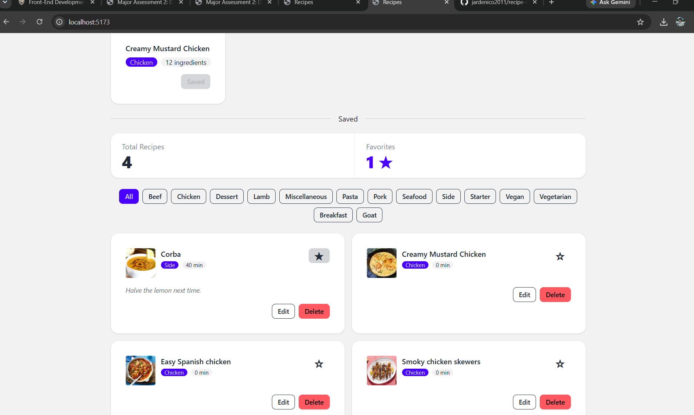

# Recipe Manager

A data-driven recipe management application built with React, TypeScript, Vite, TanStack Query, Axios, Tailwind CSS, and DaisyUI.

## Features

- Search meals using TheMealDB API.
- View and save recipes.
- Store saved recipes using JSON Server.
- Edit recipe preparation time and notes.
- Delete saved recipes.
- Toggle favorite status with optimistic updates and rollback.
- Filter saved recipes by category.
- View total recipes and favorite counts.

## Technologies Used

- React 19
- TypeScript
- Vite
- TanStack Query
- Axios
- TheMealDB API
- JSON Server
- Tailwind CSS
- DaisyUI

## Requirements

- Node.js
- npm

## Getting Started

1. Clone the repository.
2. Install dependencies:

```bash
npm install
```

3. Create the `.env` file using `.env.example`:

For Windows:

```cmd
copy .env.example .env
```

For macOS/Linux:

```bash
cp .env.example .env
```

4. Start the JSON Server in one terminal:

```bash
npm run api
```

5. Start the Vite development server in another terminal:

```bash
npm run dev
```

6. Open `http://localhost:5173` in your browser.

## Environment Variables

```env
VITE_MEALDB_URL=https://www.themealdb.com/api/json/v1/1
VITE_API_URL=http://localhost:3001
```

## Local Database

The `db.json` file contains four saved recipes. JSON Server provides the local REST API at `http://localhost:3001`.

## Production Build

Check the TypeScript code and create a production build:

```bash
npm run build
```

## Notes

This project is developed for PD 2 Major Assessment 2. The application uses TheMealDB for meal data and JSON Server for local recipe storage.

### Query Key Choices

The app uses `["recipes"]` as the query key because all saved recipe data comes from the same JSON Server endpoint. This makes it easy to fetch, update, and refresh saved recipes after mutations. The same key is also used for optimistic favorite updates and rollback to keep the displayed data consistent.

### Rollback Test

The favorite toggle uses optimistic updates. The interface updates immediately when a favorite is clicked. If the API request fails, the previous recipe data is restored using the cached query data.

The screenshot below shows the favorite state immediately after the optimistic update, before the failed request triggers rollback.

